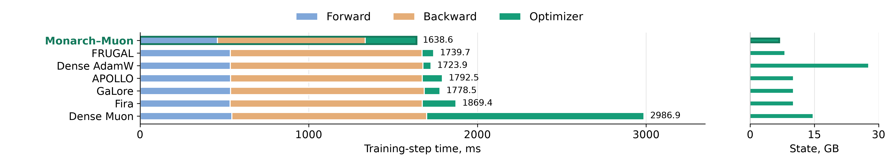

# Monarch-Muon: Structure-Aware Muon for Fast and Memory-Efficient Pretraining

Monarch-Muon applies Muon directly to the block-diagonal factors of Monarch layers. Smaller, independent
Newton-Schulz computations replace dense orthogonalization, reducing storage for weights, gradients and
optimizer state while allowing full-rank transformations. Embeddings, normalization parameters and the LM head use AdamW.

[Paper](https://arxiv.org/abs/2610.17429) · [Pretraining](pretrain/) · [Memory and time benchmarks](membench/) · [Fine-tuning](finetune/)

## Main results

At the **6.89B dense reference size**, on one H100, four-block Monarch-Muon gives:

| Metric | Dense Muon | Monarch-Muon | Reduction |
|---|---:|---:|---:|
| Full training step | 2986.9 ms | 1638.6 ms | 45% |
| Optimizer step | 1288.3 ms | 304.4 ms | 76% (4.2× faster) |
| Optimizer state | 14.60 GB | 6.77 GB | 54% |
| Peak allocated memory | 68.87 GB | 52.94 GB | 23% |



The Monarch model has **2.97B parameters**. Measurements use BF16, microbatch 4, sequence length 1024 and
four accumulation steps. Projection-based baselines exclude periodic projection refreshes.
These are training-cost benchmarks, separate from the complete pretraining runs.

- **Pretraining quality:** Muon improves validation loss over AdamW at every tested Monarch structure.
  In the dense 257M reference experiment, two-block Monarch-Muon reaches 3.06 versus 3.09 for Monarch-AdamW
  and 2.99 for dense Muon.
- **MoE:** two-block Monarch-Muon matches dense AdamW's reported validation loss of 2.68 with 15% fewer
  active and 25.4% fewer total parameters. MoE pretraining code is not included here.

See Tables 1–2 of the [paper](https://arxiv.org/html/2610.17429v1) for the full results.

## Reproduce the experiments

Each folder is self-contained, with its own `requirements.txt` and README containing the exact commands.
Provide local dataset and checkpoint paths. Pretraining also needs the GPT-2 tokenizer in the Hugging Face
cache for offline use.

| Folder | Experiments |
|---|---|
| [`pretrain/`](pretrain/) | LLaMA-style pretraining: dense AdamW, dense Muon, GaLore, Monarch-AdamW and Monarch-Muon. FP8 GEMM, optimizer states and Monarch MLP benchmarks. |
| [`membench/`](membench/) | Peak memory, optimizer state and step times at 257M–6.9B dense reference sizes, including GaLore, FRUGAL, APOLLO and Fira. |
| [`projection/`](projection/) | Dense-to-Monarch projection of Moonlight and Qwen2.5-7B: reconstruction error, KL, MMLU and GSM8K. |
| [`finetune/`](finetune/) | Qwen2.5-7B SFT on Tulu 3: full/selective conversion and closed-form, output-fit, permutation and rotation initializations. |

For a pretraining run with local FineWeb-Edu shards:

```bash
cd pretrain
pip install -r requirements.txt
bash run.sh monarch-muon-nb2 /path/to/fineweb-edu/sample/100BT
```

See [`pretrain/README.md`](pretrain/README.md) for hardware requirements, data setup and all training arms.

## Where Monarch-Muon lives

- [`MonarchLinear`](pretrain/src/models/monarch/monarch_linear.py): Monarch layer `P1 L P2 R` and its application to a model.
- [`MonarchMuonOptimizer`](pretrain/src/models/monarch/monarch_muon.py): Monarch-Muon used for the pretraining runs (heavy-ball momentum,
  per-block Newton-Schulz batched over all blocks of the same shape, per-block step scaled by `sqrt(rows/cols)`);
  selected with `--opt monarch_muon`.
- [`finetune/sft_optimizer.py`](finetune/sft_optimizer.py): the blockwise update for the 3-D Monarch factors of Qwen2.5-7B.

## Tests

Each folder has unit tests (see its README). The FP8 tests need an H100.

## License

MIT, see [`LICENSE`](LICENSE). Adapted third-party code keeps its upstream license: `pretrain/third_party/coat`
(NVlabs/COAT, Apache-2.0) and `membench/src/optim/memory_efficient/apollo` (APOLLO, CC BY-NC 4.0); see the folder
READMEs for the other adapted components.
